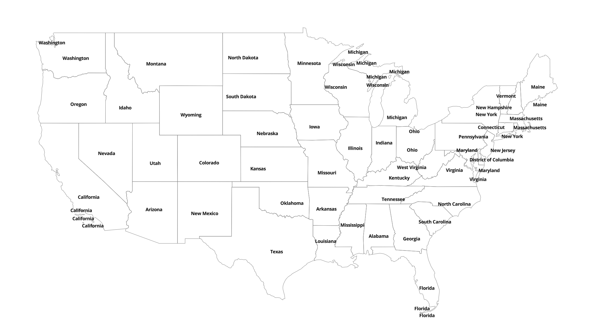
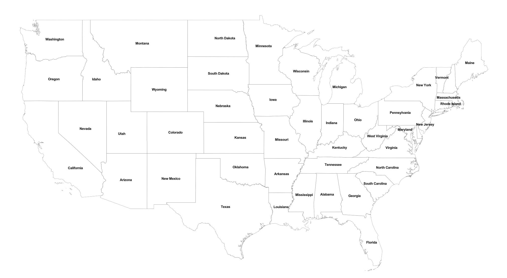

# polygon-labeler

A package for generating a single ideal location to label polygons. This is useful for mapping libraries like Maplibre GL that will generate multiple labels for polygons by default. The package uses an algorithm to find the visual center of polygons and supports grouping features by properties, handling multi-polygons, and viewport clipping for optimal performance.

## Table of Contents

[[_TOC_]]

## How it works?

The package determines optimal label placement through the following steps:

1. **Group Features**: Features are grouped by a unique identifier property (e.g., "state_name"). All polygons with the same identifier are collected together.

2. **Find Largest Polygon**: For each group, the package calculates the area of all polygons and identifies the largest polygon by area. This ensures the label is placed on the most prominent part of the feature.

3. **Calculate Center of Mass**: Using Turf.js, the center of mass, [centroid](https://turfjs.org/docs/api/centroid), is calculated for the largest polygon.

4. **Validate Position**: The package checks if the center of mass falls within the polygon boundaries:
   - **If inside**: The center of mass is used as the label point
   - **If outside**: The [polylabel algorithm](https://github.com/mapbox/polylabel) calculates the pole of inaccessibility - the most distant point from the polygon edge that's guaranteed to be inside

5. **Clip to Viewport**: Only label points that fall within the current map view bounds are included in the final output, improving rendering performance.

6. **Return GeoJSON**: The result is a [GeoJSON FeatureCollection](https://datatracker.ietf.org/doc/html/rfc7946#section-3.3) of [Point](https://datatracker.ietf.org/doc/html/rfc7946#section-3.1.2) features, each representing an optimal label location with the specified property attached.

### Example Maps

The map below shows what happens when you attempt to add labels to a polygon dataset by default. The map will display multiple label locations for each polygon due to how the data is sliced by the map.



Using `polygon-labeler` we are able to determine the optimal location for each polygon and produce a single label location for each polygon.



## Installation

```bash
npm install @statefarmins/polygon-labeler
```

## Usage

```js
import { getLabelPoints } from '@statefarmins/polygon-labeler';
import type { FeatureCollection, Polygon } from 'geojson';

const featureCollection: FeatureCollection<Polygon> = {
    type: "FeatureCollection",
    features: [
    {
        type: "Feature",
        geometry: {
            type: "Polygon",
            coordinates: [[[0, 0], [0, 4], [4, 4], [4, 0], [0, 0]]],
        },
        properties: { name: "Area1", id: "1" },
    },
    ],
};

// Define map bounds
const southWest = { lat: -10, lng: -10 };
const northEast = { lat: 10, lng: 10 };

// Get label points
const labelPoints = getLabelPoints(
  featureCollection,
  'name',
  'id',
  southWest,
  northEast
);

console.log(labelPoints);

```

## Output

```json
{
    "type": "FeatureCollection",
    "features": [
        {
            "type": "Feature",
            "geometry": { 
                "type": "Point", 
                "coordinates": [ 2, 2 ] 
            },
            "properties": { "name": "Area1" }
        }
    ]
}
```

## Maplibre GL Usage

```js
import maplibregl from 'maplibre-gl';
import { getLabelPoints } from '@statefarmins/polygon-labeler';


let lastBounds: { sw: { lat: number; lng: number }; ne: { lat: number; lng: number } } | null = null;
let lastZoom: number | null = null;

/**
 * Determine if labels should be recalculated
 * 
 * @name shouldRecalculateLabels
 * @param {map} maplibregl.Map A maplibre map
 * @param {number} tolerance The amount of allowed shift in map bounds in degrees
 * @returns {boolean} if labels should be recalculated
 */
function shouldRecalculateLabels(map: maplibregl.Map, tolerance = 0.00001): boolean {
    const bounds = map.getBounds();
    const zoom = map.getZoom();
    const sw = { lat: bounds.getSouth(), lng: bounds.getWest() };
    const ne = { lat: bounds.getNorth(), lng: bounds.getEast() };

    if (!this.lastBounds || !this.lastZoom) return true;
    if (Math.abs(this.lastZoom - zoom) > 0.01) return true;

    return (
        Math.abs(this.lastBounds.sw.lat - sw.lat) > tolerance ||
        Math.abs(this.lastBounds.sw.lng - sw.lng) > tolerance ||
        Math.abs(this.lastBounds.ne.lat - ne.lat) > tolerance ||
        Math.abs(this.lastBounds.ne.lng - ne.lng) > tolerance
    );
}

/**
 * Generate unique labels for each feature
 * 
 * @name generatePolygonLabels
 * @param {map} maplibregl.Map A maplibre map
 * @param {str} layerName The name of the source for the layer
 * @param {str} labelField The field used to label each polygon
 * @param {str} uniqueIdentifierField The field used to distinguish unique features
 * @returns {boolean} if labels should be recalculated
 */
function generatePolygonLabels(map: maplibregl.Map, layerName: str, labelField: str, uniqueIdentifierField: str) {
    if (!this.shouldRecalculateLabels(map)) {
        return;
    }

    const bounds = map.getBounds();
    const sw = { lat: bounds.getSouth(), lng: bounds.getWest() };
    const ne = { lat: bounds.getNorth(), lng: bounds.getEast() };
    this.lastBounds = { sw, ne };
    this.lastZoom = map.getZoom();

    polygonFeatures = map.queryRenderedFeatures({
        layers: [layerName]
    });

    const polygonLabelPoints = getLabelPoints(
        polygonFeatures,
        labelField,
        uniqueIdentifierField,
        sw,
        ne
    );
    map.getSource(`${layerName}_geojson`).setData(polygonLabelPoints);
}

/**
 * Reset the zoom and bounds
 * 
 *  @name clearCache
 */
function clearCache() {
    lastBounds = null;
    lastZoom = null;
}

map.on('idle', () => {
    generatePolygonLabels(map, "polygons", "name", "id");    
});
```

## Linting

```bash
npm run lint
```

## Testing

### Unit Testing

```bash
npm test
```

### Unit Testing with Coverage

```bash
npm test-with-coverage
```

### Benchmarking

```bash
npm run benchmark
```

## Contacts

- Michael Keller (mkeller3)
- Sung-Kang Yeh (leafyeh7)

## Contributing

Please read the [contributing](https://github.com/StateFarmIns/.github/blob/master/CONTRIBUTING.md) document to make contributions.
